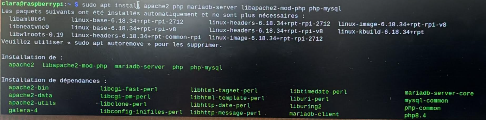
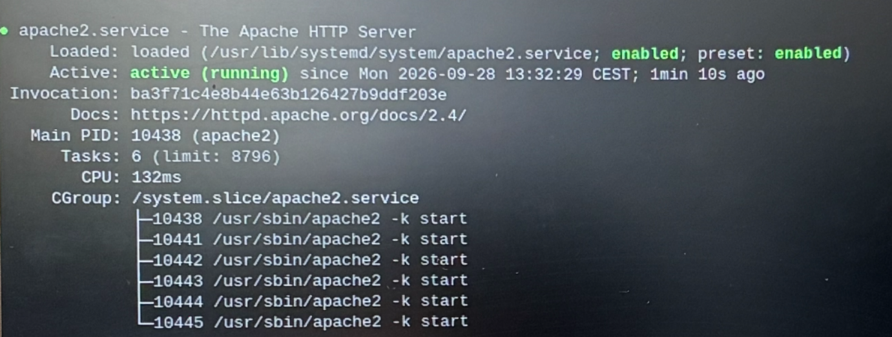
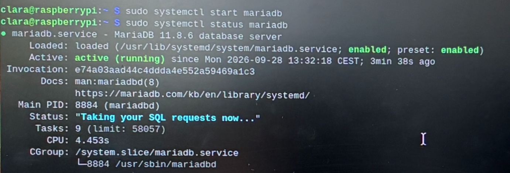

# I. Intro et installation

[Sommaire](README.md) · [II. Tests →](Partie-II-tests.md)

---

L’objectif de cette première partie est d’installer l’ensemble des composants d’un serveur web **LAMP** sur le Raspberry Pi, puis de vérifier que les services démarrent correctement.

LAMP est l’acronyme des quatre briques logicielles qui composent le serveur :

- **L**inux : le système d’exploitation (Raspberry Pi OS, basé sur Debian) ;
- **A**pache : le serveur HTTP, chargé de répondre aux requêtes des navigateurs ;
- **M**ySQL : le système de gestion de bases de données (ici MariaDB, sa version libre) ;
- **P**HP : le langage de script exécuté côté serveur pour générer des pages dynamiques.

### Installation des paquets

Tous les composants sont installés en une seule commande avec le gestionnaire de paquets APT :

```bash
sudo apt install apache2 php mariadb-server libapache2-mod-php php-mysql
```

<p align="center"></p>

APT installe le serveur Apache, l’interpréteur PHP, le serveur MariaDB, ainsi que deux modules de liaison : libapache2-mod-php, qui permet à Apache d’exécuter le code PHP, et php-mysql, qui permet à PHP de dialoguer avec la base de données.

### Démarrage et vérification d’Apache

```bash
sudo systemctl start apache2
sudo systemctl status apache2
```

<p align="center"></p>

L’état **active (running)** confirme que le service Apache est démarré. La mention **enabled** indique qu’il sera relancé automatiquement à chaque démarrage du Raspberry Pi. On voit également le processus principal et les processus enfants d’Apache, prêts à traiter les requêtes.

### Démarrage et vérification de MariaDB

```bash
sudo systemctl start mariadb
sudo systemctl status mariadb
```

<p align="center"></p>

Le service MariaDB est lui aussi à l’état **active (running)**. La ligne Status (« Taking your SQL requests now… ») indique que le serveur de bases de données est prêt à recevoir des requêtes SQL. La version installée est **MariaDB 11.8.6**.

---

[Sommaire](README.md) · [II. Tests →](Partie-II-tests.md)
