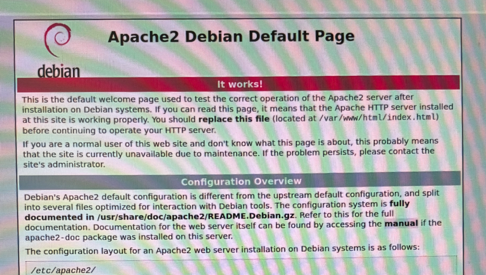
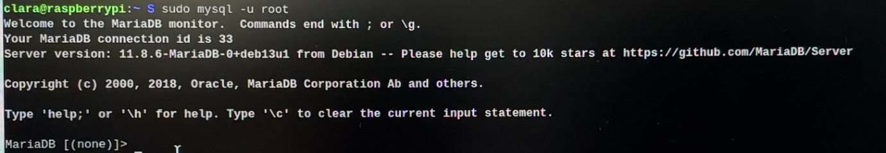
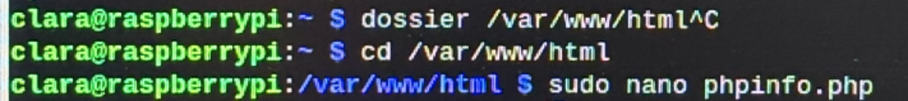
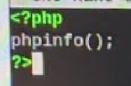
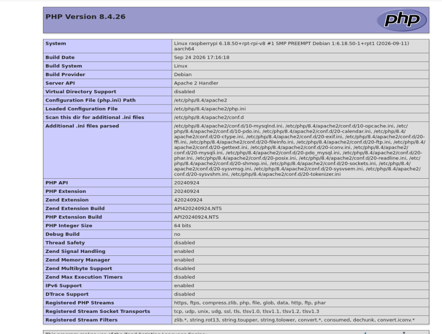

# II. Tests

[← I. Intro et installation](Partie-I-intro-et-installation.md) · [Sommaire](README.md) · [III. Utilisation →](Partie-III-utilisation.md)

---

Cette partie consiste à vérifier, un par un, le bon fonctionnement des trois services installés : le serveur web, le serveur SQL et l’interpréteur PHP.

### Serveur Apache2

Dans le navigateur du Raspberry Pi, on accède à l’adresse `http://localhost` :

<p align="center"></p>

La page par défaut **Apache2 Debian Default Page** s’affiche avec le message « It works! ». Cela prouve que le serveur Apache est opérationnel : il reçoit la requête HTTP du navigateur et lui renvoie le fichier /var/www/html/index.html.

### Serveur SQL

Dans la console :

```bash
sudo mysql -u root
```

<p align="center"></p>

La connexion au serveur MariaDB avec l’utilisateur root fonctionne : le message « Welcome to the MariaDB monitor » s’affiche avec la version du serveur (11.8.6-MariaDB). L’invite `MariaDB [(none)]>` indique qu’on est dans la console SQL, mais qu’aucune base de données n’est encore sélectionnée. Le serveur SQL est donc opérationnel. On quitte la console avec `exit`.

### Test PHP

On se place dans le dossier racine du site web, puis on crée le fichier phpinfo.php avec l’éditeur nano (avec les droits administrateur, car ce dossier appartient à root) :

```bash
cd /var/www/html
sudo nano phpinfo.php
```

<p align="center"></p>

On y écrit le code PHP suivant :

```php
<?php
phpinfo();
?>
```

<p align="center"></p>

La fonction phpinfo() génère une page qui décrit toute la configuration de PHP sur le serveur.

Dans le navigateur : `http://localhost/phpinfo.php`

<p align="center"></p>

La page de configuration de PHP s’affiche : Apache a transmis le fichier à l’interpréteur PHP, qui l’a exécuté avant de renvoyer le résultat au navigateur. PHP est donc correctement intégré à Apache. La page liste ensuite tous les modules chargés par ordre alphabétique.

**Versions installées :** PHP **8.4.26** (en-tête de la page phpinfo) et MariaDB **11.8.6** (visible avec `sudo systemctl status mariadb`).

---

[← I. Intro et installation](Partie-I-intro-et-installation.md) · [Sommaire](README.md) · [III. Utilisation →](Partie-III-utilisation.md)
