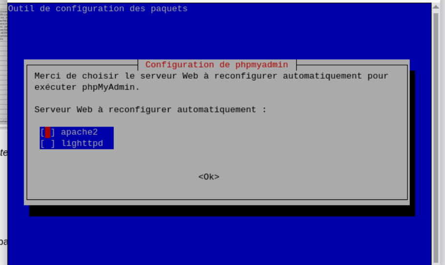
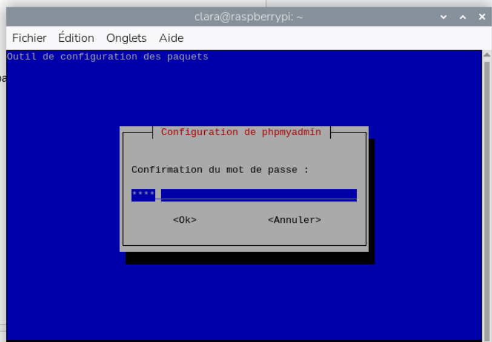
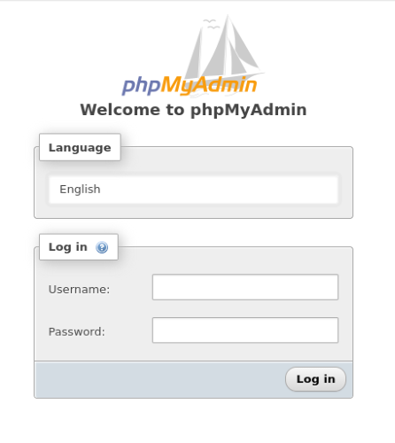
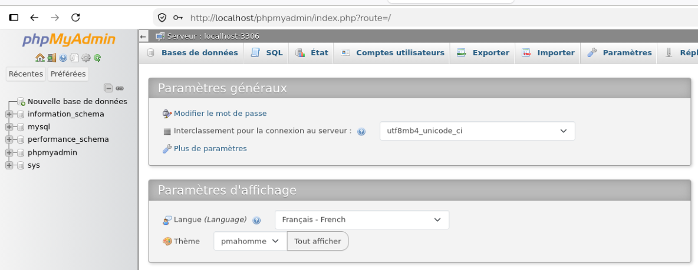
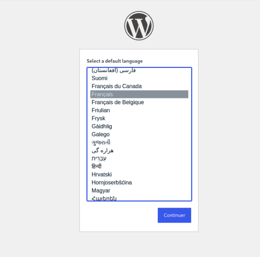
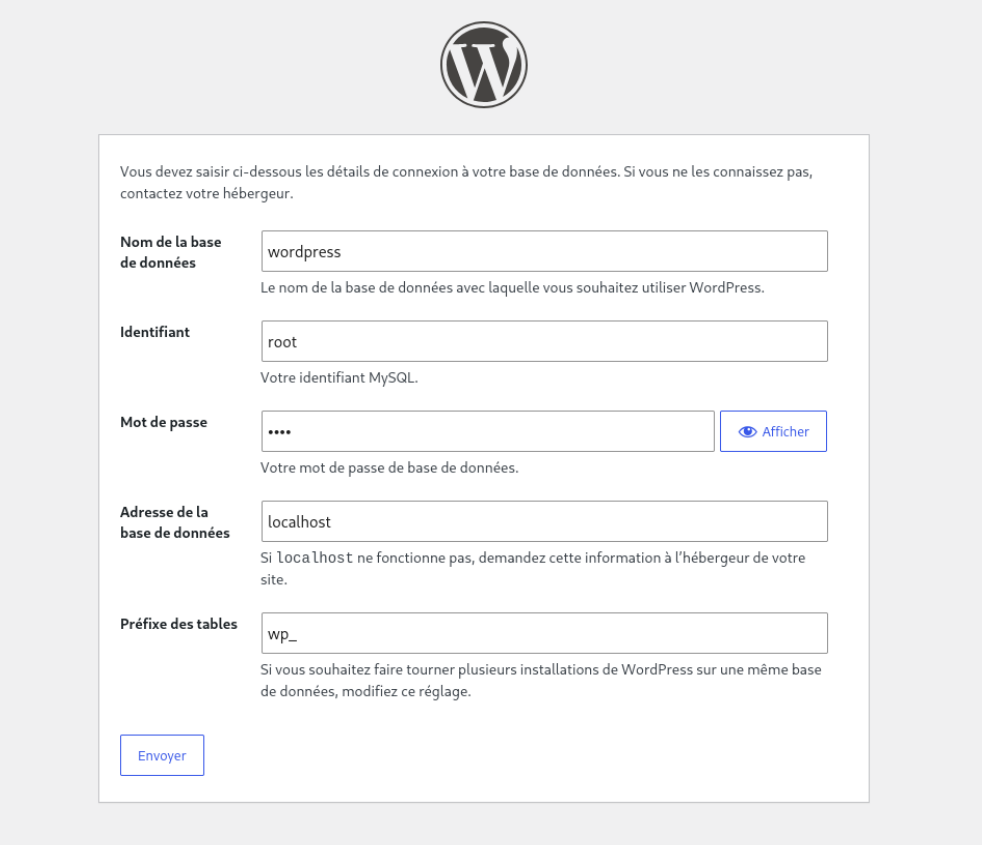
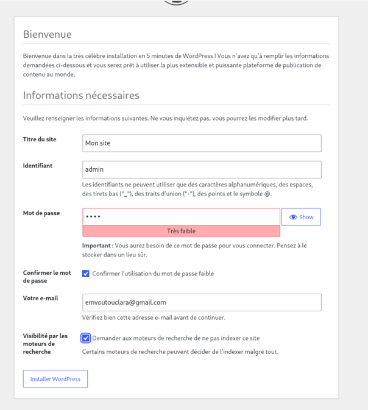
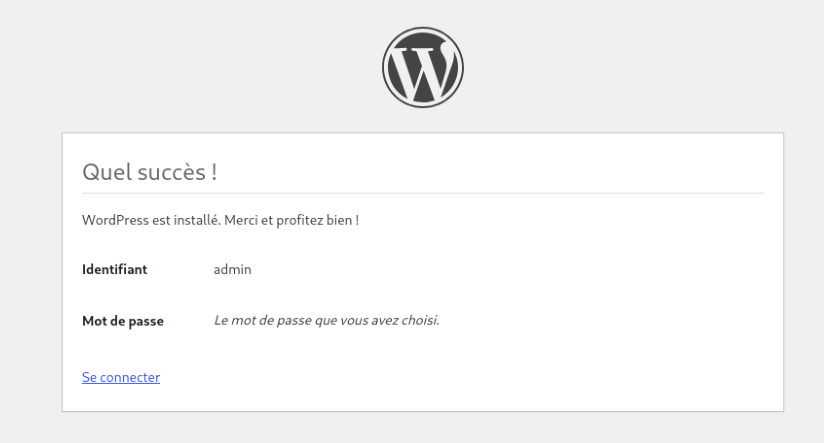
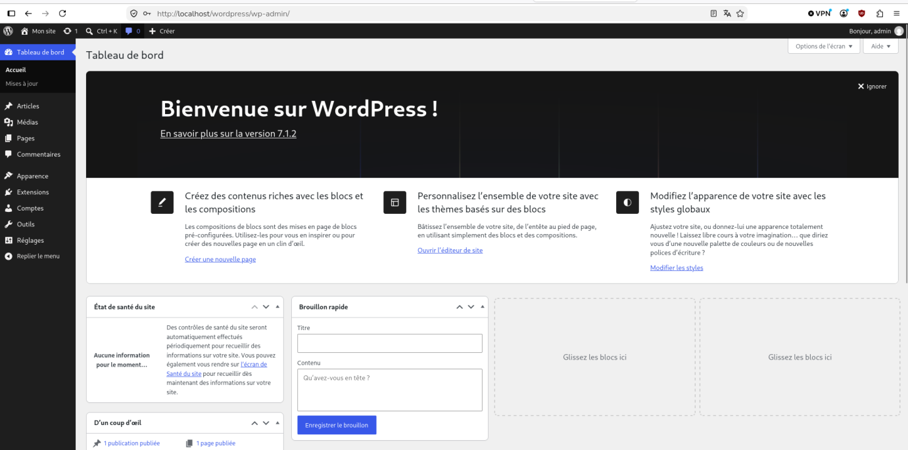

# III. Utilisation

[← II. Tests](Partie-II-tests.md) · [Sommaire](README.md) · [IV. Apache →](Partie-IV-apache.md)

**Dans cette partie :**

- [1. phpMyAdmin](#1-phpmyadmin)
- [2. WordPress](#2-wordpress)

---

La pile LAMP étant opérationnelle, on installe deux applications web qui l’utilisent : phpMyAdmin, pour administrer les bases de données depuis un navigateur, et WordPress, un gestionnaire de contenu (CMS).

## 1. phpMyAdmin

```bash
sudo apt install phpmyadmin
```

Pendant l’installation, l’assistant demande quel serveur web doit être configuré automatiquement. On sélectionne **apache2** :

<p align="center"></p>

L’assistant demande ensuite de définir et de confirmer le mot de passe du compte phpmyadmin, utilisé par l’application pour accéder à sa propre base de données :

<p align="center"></p>

phpMyAdmin est alors accessible à l’adresse `http://localhost/phpmyadmin`, qui affiche sa page de connexion :

<p align="center"></p>

Par défaut sous Debian, le compte root de MariaDB utilise l’authentification unix_socket : il ne peut se connecter qu’en ligne de commande avec sudo, et non depuis phpMyAdmin. Pour permettre la connexion à l’interface web, on définit un mot de passe pour root :

```sql
sudo mysql -u root
ALTER USER 'root'@'localhost' IDENTIFIED VIA mysql_native_password USING PASSWORD('root');
FLUSH PRIVILEGES;
EXIT;
```

La commande ALTER USER associe un mot de passe au compte root, et FLUSH PRIVILEGES recharge les droits pour que la modification soit prise en compte immédiatement.

<p align="center"></p>

La connexion à phpMyAdmin avec le compte root fonctionne : l’interface d’administration s’affiche, avec la liste des bases de données dans le panneau de gauche.

## 2. WordPress

### Télécharger WordPress

On télécharge la dernière version officielle de WordPress dans le dossier racine d’Apache, puis on décompresse l’archive :

```bash
cd /var/www/html
sudo wget https://wordpress.org/latest.tar.gz
sudo tar -xzvf latest.tar.gz
```

La décompression crée le dossier /var/www/html/wordpress, qui contient tous les fichiers de l’application.

### Donner les permissions nécessaires à Apache

```bash
sudo chown -R www-data:www-data /var/www/html/wordpress
sudo chmod -R 755 /var/www/html/wordpress
```

Apache s’exécute sous l’identité www-data. La commande chown lui attribue la propriété du dossier WordPress, pour qu’il puisse y écrire (fichier de configuration, médias, extensions). La commande chmod 755 donne tous les droits au propriétaire, et seulement la lecture et l’exécution aux autres utilisateurs.

### Installation de WordPress

L’installation se poursuit dans le navigateur, à l’adresse `http://localhost/wordpress/`. La première étape est le choix de la langue :

<p align="center"></p>

On configure ensuite la connexion entre WordPress et MariaDB : nom de la base de données (wordpress), identifiant et mot de passe du compte SQL (root), adresse du serveur de base de données (localhost, car MariaDB est sur la même machine) et préfixe des tables (wp_).

<p align="center"></p>

On renseigne les informations générales du site (titre) et on crée le compte administrateur de WordPress :

<p align="center"></p>

WordPress confirme que l’installation est terminée et propose de se connecter :

<p align="center"></p>

Après connexion avec le compte administrateur, le tableau de bord de WordPress s’affiche. Le site est installé et fonctionne grâce aux trois composants de la pile : Apache sert les pages, PHP exécute le code de WordPress et MariaDB stocke son contenu.

<p align="center"></p>

---

[← II. Tests](Partie-II-tests.md) · [Sommaire](README.md) · [IV. Apache →](Partie-IV-apache.md)
