# IV. Apache

[← III. Utilisation](Partie-III-utilisation.md) · [Sommaire](README.md) · [V. Utilisation de MySQL (MariaDB) →](Partie-V-utilisation-de-mysql-mariadb.md)

**Dans cette partie :**

- [1) Historique](#1-historique)
- [2) HTTP](#2-http)
- [3) Configuration de base](#3-configuration-de-base)
- [4) Script CGI simple](#4-script-cgi-simple)
- [5) Protection des accès](#5-protection-des-accès)
- [6) Serveurs virtuels (consignes)](#6-serveurs-virtuels-consignes)
- [6) Serveurs virtuels (réalisation)](#6-serveurs-virtuels-réalisation)
- [7) Le HTTP sécurisé HTTPS](#7-le-http-sécurisé-https)

---

Cette partie porte sur le protocole HTTP et sur la configuration du serveur Apache : nom du serveur, fichiers de logs, accès aux dossiers, scripts CGI, protection des accès, serveurs virtuels et enfin passage en HTTPS.

## 1) Historique

- Internet : milieu des années 60, DoD (département de la Défense américain)
- World Wide Web : 1989, CERN
- Mosaic (premier navigateur grand public) : 1993
  - Netscape : 1994
  - Firefox : 2004
- Internet Explorer : 1994, Microsoft

## 2) HTTP

HTTP (HyperText Transfer Protocol) est le protocole de communication entre un navigateur et un serveur web. Sa version 2 date de 2015.

**Déroulement d’une connexion :**

1. connexion du client au serveur ;
2. envoi d’une requête par le client ;
3. réponse du serveur ;
4. requête de déconnexion ;
5. réponse du serveur ;
6. fermeture de la connexion.

**Méthodes utilisées dans une requête :**

- GET : récupère un document
- HEAD : demande uniquement l’en-tête
- POST : envoie des données au serveur
- PUT : envoie un fichier
- DELETE : supprime une ressource
- CONNECT : établit un tunnel (utilisé pour le HTTPS via un proxy)

**En-têtes dans le protocole HTTP :**

- Host : nom du serveur
- User-Agent : nom du navigateur
- Accept : formats de fichiers acceptés
- Accept-Language : langues acceptées
- Authorization : identifiants d’authentification
- Date : date de la réponse
- Server : logiciel serveur utilisé
- Content-Type : format des données

**Codes de réponse :**

- de 100 à 199 : message informatif
- de 200 à 299 : succès de la requête
- de 300 à 399 : redirection
- de 400 à 499 : erreur côté client
  - 401 : requête non autorisée
  - 404 : fichier inexistant
  - 405 : méthode (GET ou POST) non autorisée
- de 500 à 599 : erreur interne du serveur

### Analyser quelques trames avec Wireshark

On lance une capture Wireshark sur la carte Ethernet 2 du PC, avec le filtre d’affichage `http.request` pour n’afficher que les requêtes HTTP :

<p align="center">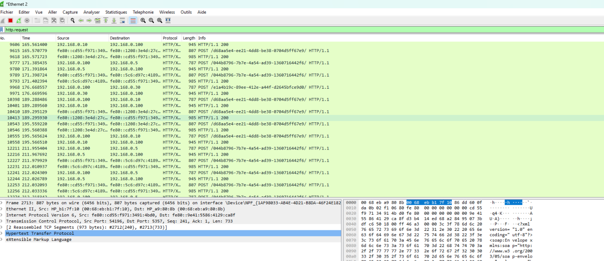</p>

L’interface de Wireshark se divise en trois zones :

- **La liste des paquets (en haut)** : chaque ligne correspond à une trame capturée, avec sa source, sa destination, son protocole et un résumé. On y repère plusieurs requêtes POST suivies de réponses 200 OK, ce qui signifie que les échanges ont abouti.
- **Le détail du paquet (au milieu)** : en sélectionnant une trame, Wireshark la décompose couche par couche (Ethernet, IP, TCP, puis HTTP). On constate que ces échanges utilisent le port 5357, réservé par Windows au service WSD (Web Services for Devices), qui dialogue avec les périphériques du réseau comme les imprimantes.

<p align="center">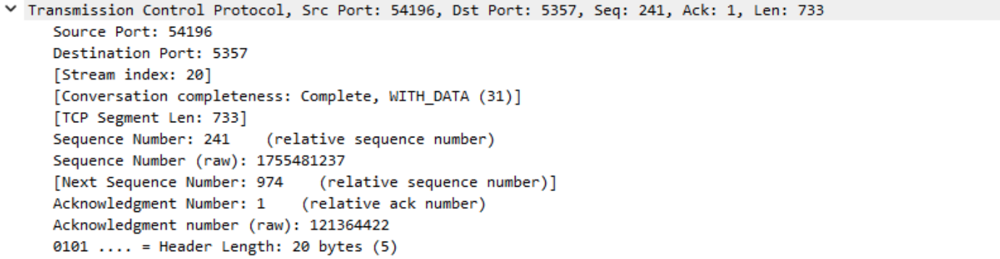</p>

- **Les données brutes (en bas)** : le contenu du paquet en hexadécimal et en ASCII. On y lit des messages au format XML/SOAP, caractéristiques du protocole WSD.

### Test d’un mot de passe en HTTP

Pour observer la circulation d’un mot de passe en HTTP, on crée une page contenant un formulaire :

```bash
sudo nano /var/www/html/motdepasse.htm
```

```html
<html>
    <head>
        <title>Test Mot de passe</title>
    </head>
    <body>
        <h1>Test mot de passe</h1>
        <form action="motdepasse.htm" method="post">
            <input type="text" id="passe" name="passwd" />
            <button type="submit">Envoyer</button>
        </form>
    </body>
</html>
```

Le formulaire envoie le contenu du champ passwd au serveur avec la méthode POST. Depuis le PC Windows, la page s’affiche correctement :

<p align="center">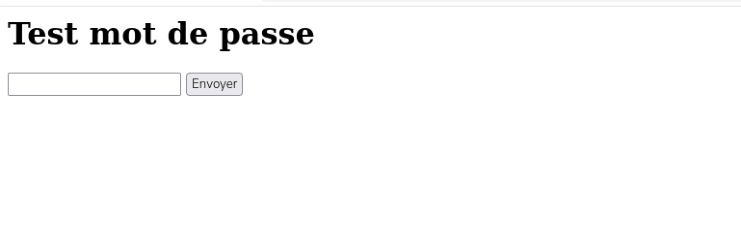</p>

**Analyse Wireshark :**

1. On lance la capture sur la carte réseau du PC.
2. Depuis le PC, on ouvre la page motdepasse.htm, on saisit un mot de passe puis on clique sur « Envoyer ».
3. Dans Wireshark, on applique le filtre `http` pour retrouver la requête POST /motdepasse.htm (paquet n°41).

<p align="center">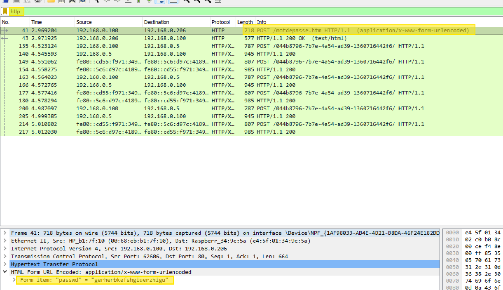</p>

Dans le détail du paquet, la section HTML Form URL Encoded affiche le champ passwd et sa valeur **en clair**. Toute personne capable d’intercepter le trafic sur le réseau peut donc lire le mot de passe saisi.

> [!IMPORTANT]
> **Conclusion :** HTTP ne chiffre pas les données. Les informations envoyées, y compris les mots de passe, circulent en clair sur le réseau. Pour les protéger, il faut utiliser HTTPS (voir la partie 7).

### La fondation Apache

L’Apache Software Foundation, créée en 1995, a pour objet le développement de logiciels libres.

Elle ne compte pas de salariés mais des centaines de bénévoles répartis dans le monde, qui travaillent sur une centaine de projets, dont le serveur HTTP Apache (utilisé dans ce TP), Apache Directory pour LDAP (2002), OpenOffice (2011) et SpamAssassin (2004).

La licence Apache est compatible avec la GNU GPL, mais elle n’oblige pas à publier sous licence libre le code modifié.

Le serveur HTTP Apache est en version 2.4 depuis 2012. Il équipe plus de 50 % des serveurs web (son principal concurrent est NGINX) et repose sur une conception modulaire : on lui ajoute des fonctionnalités par modules (mod-php, mod-ssl, etc.).

## 3) Configuration de base

### Nom de la machine

```bash
sudo hostnamectl set-hostname nom_du_serveur
```

<p align="center">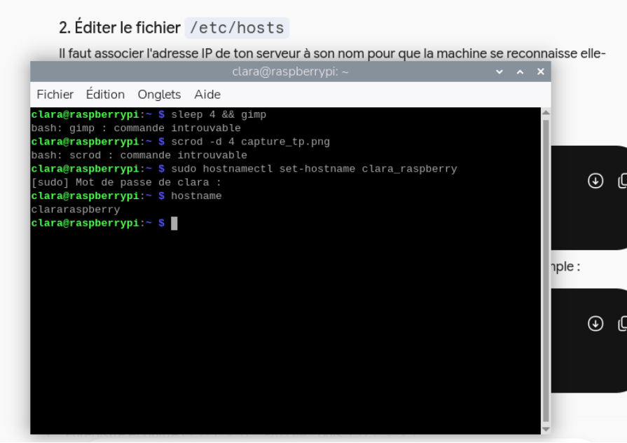</p>

La commande hostnamectl modifie le nom d’hôte du Raspberry Pi, qui devient **clararaspberry**.

Dans le fichier `/etc/hosts`, on associe l’adresse IP du Raspberry Pi à ce nom, pour que la machine puisse être jointe par son nom :

```text
192.168.0.206    clararaspberry
```

<p align="center">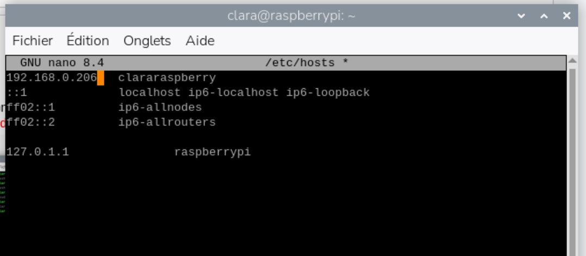</p>

Dans le fichier de configuration principal d’Apache `/etc/apache2/apache2.conf`, on déclare le nom du serveur avec la directive ServerName :

```apache
ServerName clararaspberry
```

<p align="center">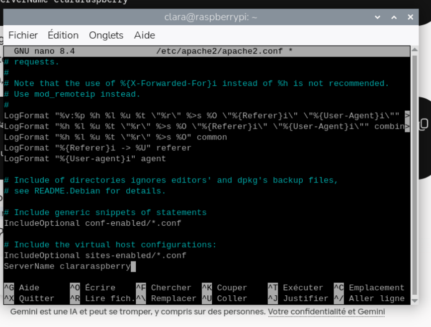</p>

On relance Apache pour appliquer la modification :

```bash
sudo systemctl restart apache2
```

Test depuis le PC Windows : `http://clararaspberry`

<p align="center">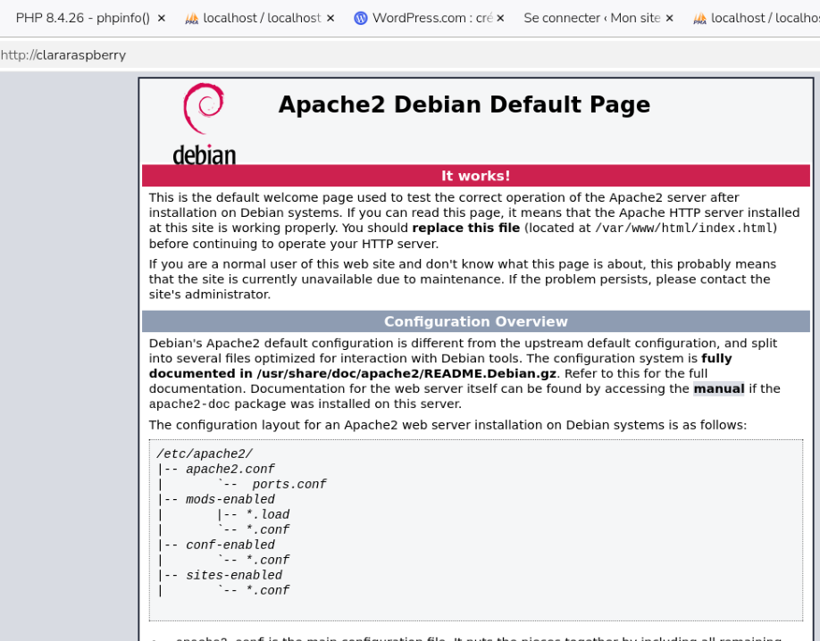</p>

La page par défaut d’Apache s’affiche en utilisant le nom du serveur au lieu de son adresse IP : la résolution de nom et la configuration d’Apache fonctionnent.

### Fichier de configuration : questions

1. **Quelle directive spécifie le port à écouter ? Quel est le port par défaut ?** C’est la directive **Listen**, définie dans `/etc/apache2/ports.conf`. Le port par défaut est 80 pour HTTP et 443 pour HTTPS.

<p align="center">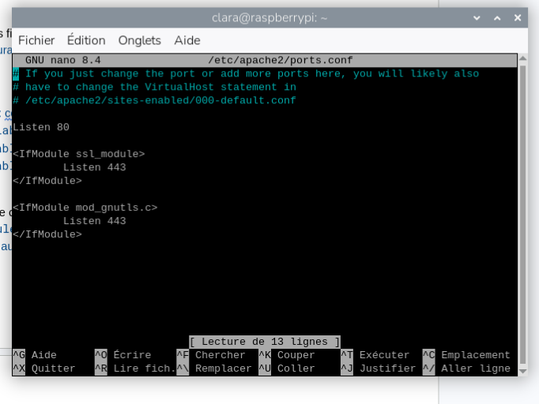</p>

1. **Y a-t-il d’autres fichiers de configuration ? Où ?** Oui, dans `/etc/apache2/` : ports.conf (ports d’écoute), sites-available/ et sites-enabled/ (sites web), mods-available/ et mods-enabled/ (modules), conf-available/ et conf-enabled/ (configurations complémentaires). Les dossiers « available » contiennent tout ce qui est disponible, les dossiers « enabled » ce qui est réellement activé.
2. **Quelle directive charge un module ?** La directive **LoadModule**. Sous Debian, on active un module avec la commande `a2enmod` et on le désactive avec `a2dismod`.
3. **Sous quelle identité (user, group) s’exécute le serveur ? uid et gid ?** Les directives **User** et **Group** définissent l’identité d’Apache. Par défaut, il s’agit de l’utilisateur et du groupe **www-data**. Leurs UID et GID s’affichent avec la commande `id www-data`.
4. **Quel est le répertoire racine des documents servis ?** La directive **DocumentRoot** le définit. Par défaut, il s’agit de `/var/www/html`.
5. **Quelle page renvoie Apache quand l’URL est un dossier ?** La directive **DirectoryIndex** définit les fichiers recherchés dans ce cas : index.html, index.htm, index.php, etc.
6. **Comment sont traitées les URL de la forme http://serveur/cgi-bin/toto ?** La directive **ScriptAlias** associe /cgi-bin/ au dossier des scripts CGI : Apache exécute le script sur le serveur et renvoie son résultat au navigateur, au lieu d’envoyer le fichier lui-même.
7. **Où sont les fichiers de logs ? Quels noms ?** Dans `/var/log/apache2/`. Les principaux sont **access.log**, qui enregistre chaque requête reçue, et **error.log**, qui enregistre les erreurs et les messages du serveur.

### Fichiers de logs

On crée une page HTML minimale, test.htm, à la racine du site :

```bash
sudo nano /var/www/html/test.htm
```

```html
<html>
    <head>
        <title>Test</title>
    </head>
    <body>
        <h1>Hello world !</h1>
    </body>
</html>
```

**Quand on lance le service apache2, dans quel fichier de log constate-t-on le démarrage ?**

Le démarrage est enregistré dans `/var/log/apache2/error.log`. Pour le vérifier, on redémarre le service puis on affiche les dernières lignes du fichier :

```bash
sudo systemctl restart apache2
sudo tail -n 20 /var/log/apache2/error.log
```

<p align="center">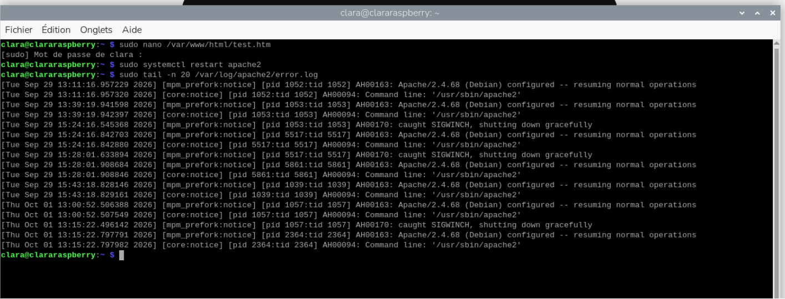</p>

Chaque redémarrage laisse une trace horodatée : on y voit l’arrêt du serveur (caught SIGTERM, shutting down), puis son redémarrage avec le message **« configured -- resuming normal operations »**, qui confirme qu’Apache a relu sa configuration et fonctionne normalement.

**Accédez à la page test.htm depuis une autre machine. Dans quel fichier de log voit-on la consultation ?**

Depuis le navigateur du PC Windows : `http://clararaspberry/test.htm`

<p align="center">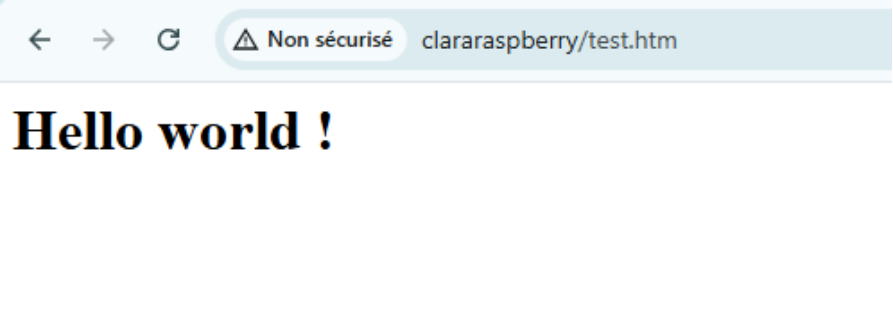</p>

Sur le Raspberry Pi, on consulte le journal des accès :

```bash
sudo tail -n 20 /var/log/apache2/access.log
```

<p align="center">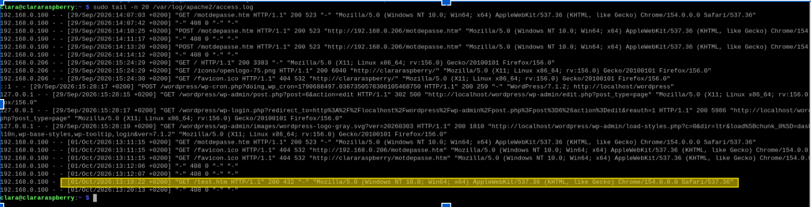</p>

La consultation est enregistrée dans **access.log**. La ligne surlignée se lit ainsi :

- **192.168.0.100** : adresse IP du client (le PC Windows) ;
- **01/Oct/2026:13:19:22** : date et heure de la requête ;
- **GET /test.htm** : méthode HTTP et ressource demandée ;
- **200** : code de réponse, la page a été envoyée avec succès.

### Accès aux dossiers

**1. Création d’un dossier webftp et copie de test.htm**

```bash
sudo mkdir /var/www/html/webftp
sudo cp /var/www/html/test.htm /var/www/html/webftp/
```

Test depuis le PC Windows : `http://clararaspberry/webftp/test.htm`

<p align="center">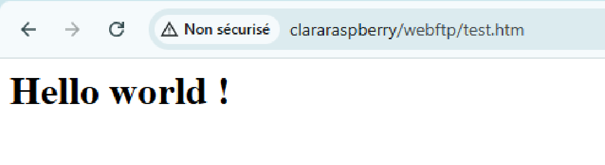</p>

La page « Hello world ! » s’affiche : le fichier est bien servi depuis le sous-dossier.

**2. Accès au dossier sans préciser de fichier** : `http://clararaspberry/webftp/`

<p align="center">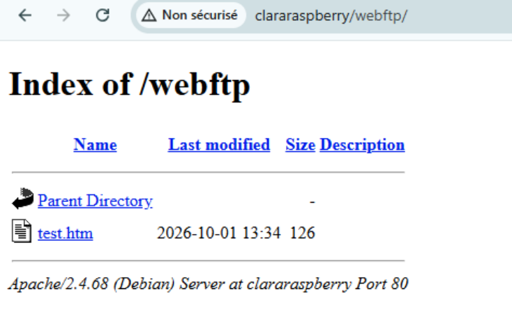</p>

Comme le dossier ne contient pas de fichier index, Apache génère automatiquement une page « Index of /webftp » qui liste son contenu.

**3. Renommer test.htm en index.htm**

```bash
sudo mv /var/www/html/webftp/test.htm /var/www/html/webftp/index.htm
```

En actualisant `http://clararaspberry/webftp/` :

<p align="center">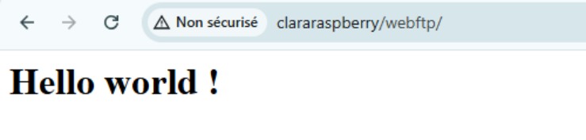</p>

La page « Hello world ! » s’affiche directement, sans liste de fichiers.

**4. Pourquoi ?** C’est l’effet de la directive **DirectoryIndex** : lorsqu’une URL désigne un dossier, Apache cherche d’abord un fichier index.html ou index.htm à l’intérieur et l’affiche automatiquement. Il ne génère la liste des fichiers que si aucun fichier index n’est présent.

**5. Contrôler l’affichage du contenu du dossier (Options Indexes)**

On ajoute un bloc Directory pour le dossier webftp dans `apache2.conf` :

```apache
<Directory /var/www/html/webftp>
    Options -Indexes
</Directory>
```

Avec **-Indexes**, Apache n’a plus le droit de générer la liste des fichiers. En l’absence de fichier index, il renvoie une erreur **403 Forbidden** : le contenu du dossier reste caché.

<p align="center">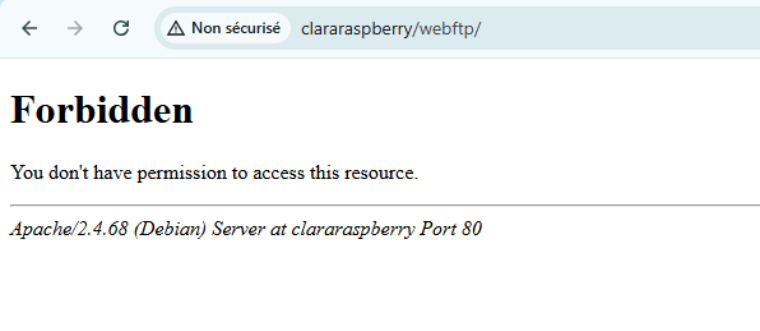</p>

```apache
<Directory /var/www/html/webftp>
    Options +Indexes
</Directory>
```

Avec **+Indexes**, Apache affiche à nouveau la liste des fichiers lorsqu’il n’y a pas de fichier index. Ici, le fichier index.htm étant présent, c’est lui qui est affiché :

<p align="center">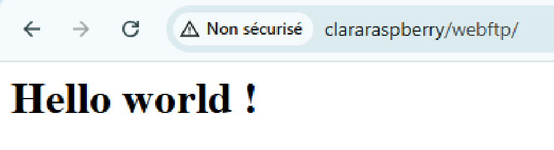</p>

Désactiver l’option Indexes est une bonne pratique de sécurité : cela évite d’exposer la liste des fichiers d’un dossier à n’importe quel visiteur.

## 4) Script CGI simple

Un script CGI (Common Gateway Interface) est un programme exécuté par le serveur web, dont le résultat est renvoyé au navigateur. On écrit un script Bash qui renvoie la date et l’heure :

```bash
sudo nano /usr/lib/cgi-bin/date.sh
```

```bash
#!/bin/bash
echo "Content-type: text/html"
echo ""
date +"%A %d %B %Y %T"
```

La ligne Content-type indique au navigateur le type de contenu renvoyé. La ligne vide qui suit est obligatoire : elle sépare l’en-tête HTTP du contenu.

**Où placer le script ? Faut-il configurer quelque chose ?**

Sous Debian, les scripts CGI se placent dans `/usr/lib/cgi-bin/`, le dossier associé à l’URL /cgi-bin/ par la directive ScriptAlias. Il faut activer le module CGI et la configuration correspondante, puis redémarrer Apache :

```bash
sudo a2enmod cgi
sudo a2enconf serve-cgi-bin
sudo systemctl restart apache2
```

Le script doit aussi être exécutable :

```bash
sudo chmod +x /usr/lib/cgi-bin/date.sh
```

Test : `http://clararaspberry/cgi-bin/date.sh`

<p align="center">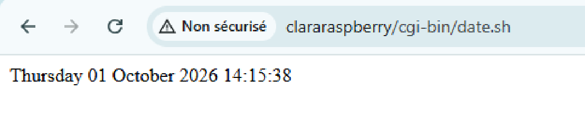</p>

Le navigateur affiche la date et l’heure générées par le script au moment de la requête : le module CGI est actif et le script est bien exécuté par le serveur.

**Script qui affiche la liste des processus d’un utilisateur donné : listprocs.sh**

```bash
sudo nano /usr/lib/cgi-bin/listprocs.sh
```

```bash
#!/bin/bash
echo "Content-type: text/plain"
echo ""
user=$(echo "$QUERY_STRING" | grep -oP '(?<=user=)\w+')
ps -u $user
```

```bash
sudo chmod +x /usr/lib/cgi-bin/listprocs.sh
```

La variable QUERY_STRING contient les paramètres passés dans l’URL après le « ? ». Le script en extrait la valeur de user, puis affiche les processus de cet utilisateur avec la commande ps.

Test : `http://clararaspberry/cgi-bin/listprocs.sh?user=root`

<p align="center">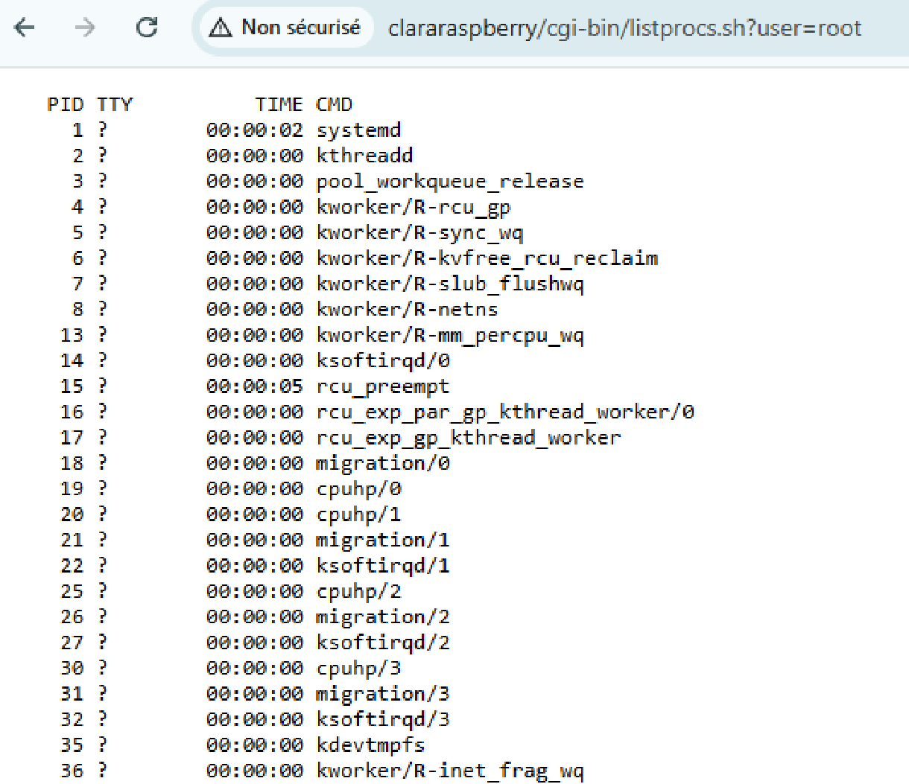</p>

Le script a bien récupéré le paramètre user=root et affiche la liste des processus de l’utilisateur root (PID, terminal, temps d’exécution et nom de la commande).

**Page HTML avec un formulaire simple permettant la saisie du nom de l’utilisateur :**

```html
<form method="get" action="/cgi-bin/user.sh">
    <input type="text" name="user" />
</form>
```

Avec la méthode GET, le formulaire ajoute automatiquement ?user=<nom saisi> à l’URL du script. Le script user.sh traite ce paramètre de la même façon que listprocs.sh :

```bash
#!/bin/bash
echo "Content-type: text/html"
echo ""
user=$(echo "$QUERY_STRING" | grep -oP '(?<=user=)\w+')
echo "<pre>"
ps -u $user
echo "</pre>"
```

## 5) Protection des accès

### Dossier secret accessible uniquement depuis localhost

```bash
sudo mkdir /var/www/html/secret
sudo cp /var/www/html/test.htm /var/www/html/secret/
```

On ajoute un bloc Directory pour ce dossier à la fin de `/etc/apache2/apache2.conf` :

```bash
sudo nano /etc/apache2/apache2.conf
```

```apache
<Directory /var/www/html/secret>
    Require local
</Directory>
```

La directive **Require local** n’autorise que les requêtes provenant de la machine elle-même (localhost). On redémarre Apache :

```bash
sudo systemctl restart apache2
```

Test depuis le PC Windows : `http://clararaspberry/secret/test.htm`

<p align="center">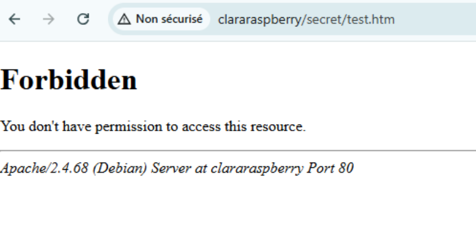</p>

Apache renvoie une erreur **403 Forbidden** : le PC n’étant pas la machine locale, l’accès lui est refusé.

**Que remarque-t-on dans les logs si on cherche à y accéder depuis une autre machine ?**

```bash
sudo tail -n 20 /var/log/apache2/error.log
```

<p align="center">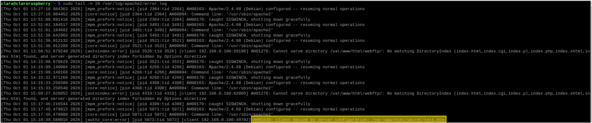</p>

Chaque tentative est enregistrée dans error.log avec le code **AH01630: client denied by server configuration**, suivi de l’adresse IP du PC et du fichier demandé (/var/www/html/secret/test.htm). L’administrateur peut ainsi repérer les tentatives d’accès refusées.

### Dossier prive accessible uniquement aux utilisateurs authentifiés

```bash
sudo mkdir /var/www/html/prive
sudo cp /var/www/html/test.htm /var/www/html/prive/
```

Ce dossier doit être réservé à des utilisateurs authentifiés par Apache (et non à des comptes Linux). On crée un fichier .htaccess dans le dossier :

```bash
sudo nano /var/www/html/prive/.htaccess
```

```apache
AuthUserFile /etc/apache2/users
AuthGroupFile /dev/null
AuthName "Accès privé"
AuthType Basic
Require valid-user
```

- **AuthUserFile** : fichier contenant les comptes autorisés et leurs mots de passe ;
- **AuthName** : message affiché dans la fenêtre de connexion ;
- **AuthType Basic** : authentification HTTP de base ;
- **Require valid-user** : tout utilisateur présent dans le fichier peut accéder au dossier.

On crée un utilisateur Apache avec la commande htpasswd (l’option -c crée le fichier) :

```bash
sudo htpasswd -c /etc/apache2/users admin
```

<p align="center">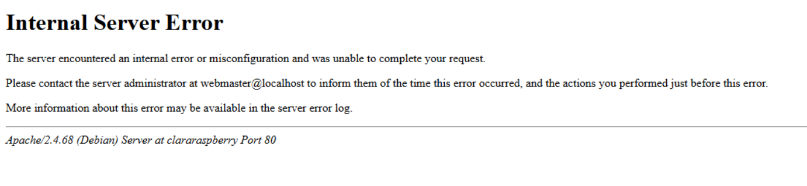</p>

À ce stade, l’accès au dossier renvoie une erreur **500 Internal Server Error** : la configuration d’Apache ne permet pas encore d’utiliser ces directives. Dans `apache2.conf`, on autorise le fichier .htaccess à définir l’authentification :

```apache
<Directory /var/www/html/prive>
    AllowOverride AuthConfig
    Options -Indexes
</Directory>
```

On active les modules nécessaires à l’authentification par fichier et à la gestion des groupes, puis on redémarre Apache :

```bash
sudo a2enmod authn_file authz_groupfile
sudo systemctl restart apache2
```

<p align="center">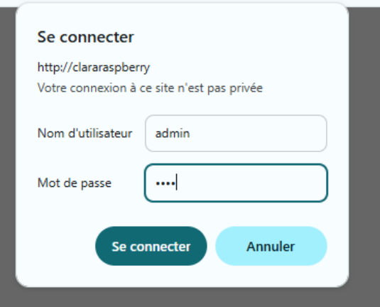</p>

Une fenêtre d’authentification s’affiche désormais : seuls les utilisateurs enregistrés dans /etc/apache2/users peuvent accéder au contenu du dossier prive.

## 6) Serveurs virtuels (consignes)

Une seule machine, avec une seule adresse IP, doit héberger plusieurs sites (virtual hosts) :

- donner plusieurs noms à la machine dans /etc/hosts (au moins un deuxième) ;
- ajouter dans le fichier apache2.conf :

```apache
<Directory "/var/www/html">
    Options Indexes FollowSymLinks
    AllowOverride None
    Order deny,allow
    Deny from all
    Allow from localhost 192.168.0.0/255.255.255.0
</Directory>

<Directory "/var/www/html/totoweb">
    Options Indexes FollowSymLinks
    Order deny,allow
    Deny from all
    Allow from localhost 192.168.0.0/255.255.255.0
</Directory>

NameVirtualHost 192.168.0.X

<VirtualHost 192.168.0.X>
    DocumentRoot /var/www/html
    ServerName principale.name.fr
</VirtualHost>
<VirtualHost 192.168.0.X>
    DocumentRoot /var/www/html/totoweb
    ServerName totoweb.name.fr
</VirtualHost>
```

(192.168.0.X correspond à l’adresse IP du Raspberry Pi.)

## 6) Serveurs virtuels (réalisation)

**Étape 1 : vérifier la présence du répertoire racine dans le fichier de configuration.** Avant d’ajouter les serveurs virtuels, on vérifie quels blocs Directory existent déjà dans apache2.conf :

```bash
sudo grep -n "/var/www/html" /etc/apache2/apache2.conf
```

**Étape 2 : ajouter les VirtualHost à la fin du fichier**, avec un fichier de log distinct pour chaque site :

```bash
sudo nano /etc/apache2/apache2.conf
```

```apache
<VirtualHost 192.168.0.206>
    DocumentRoot /var/www/html
    ServerName principale.name.fr
    ErrorLog ${APACHE_LOG_DIR}/principale_error.log
    CustomLog ${APACHE_LOG_DIR}/principale_access.log combined
</VirtualHost>

<VirtualHost 192.168.0.206>
    DocumentRoot /var/www/html/totoweb
    ServerName totoweb.name.fr
    ErrorLog ${APACHE_LOG_DIR}/totoweb_error.log
    CustomLog ${APACHE_LOG_DIR}/totoweb_access.log combined
</VirtualHost>
```

Apache choisit le VirtualHost à utiliser en comparant le nom demandé par le navigateur (en-tête Host) à la directive ServerName de chaque bloc.

**Étape 3 : créer le dossier racine du deuxième site (totoweb)** :

```bash
sudo mkdir /var/www/html/totoweb
```

<p align="center">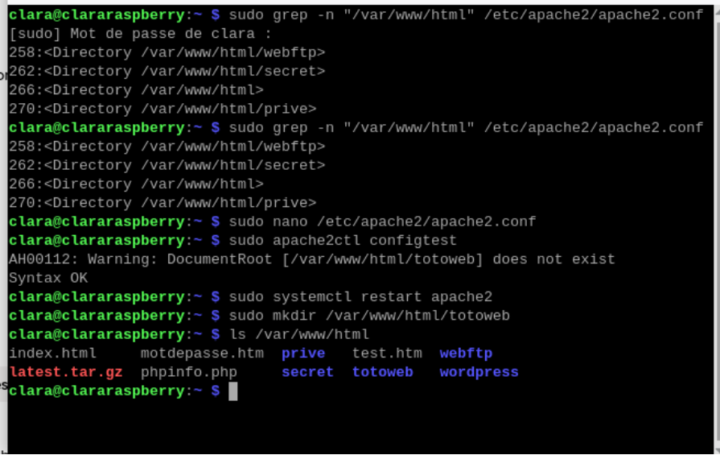</p>

**Étape 4 : placer une page de test dans ce dossier** :

```bash
sudo nano /var/www/html/totoweb/index.html
```

```html
<html>
    <head><title>Site Toto</title></head>
    <body><h1>Bienvenue sur totoweb.name.fr !</h1></body>
</html>
```

**Étape 5 : test.** Après une visite du site totoweb, on affiche les dernières lignes de son fichier de log :

```bash
sudo tail -n 5 /var/log/apache2/totoweb_access.log
```

<p align="center">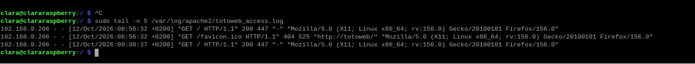</p>

Les requêtes destinées au site totoweb sont enregistrées dans son propre fichier totoweb_access.log : les deux sites sont bien distincts, y compris dans leurs journaux.

**Comment séparer les logs des 2 sites ?** En définissant les directives **ErrorLog** et **CustomLog** dans chaque VirtualHost, avec un nom de fichier différent pour chaque site. Les accès et les erreurs de chaque site sont ainsi enregistrés séparément, ce qui facilite leur analyse.

## 7) Le HTTP sécurisé HTTPS

HTTP utilise par défaut le port 80 et transmet les données en clair. HTTPS utilise le port 443 et chiffre les échanges grâce au protocole TLS. Dans cette partie, on utilise le certificat SSL fourni par défaut.

### Étape préalable : correction des VirtualHost

> [!WARNING]
> Dans la partie 6, les VirtualHost avaient été déclarés avec l’adresse IP sans préciser de port (`<VirtualHost 192.168.0.206>`). Ils s’appliquaient donc aussi au port 443, sans chiffrement, ce qui aurait empêché le HTTPS de fonctionner. On précise donc le port 80 dans apache2.conf :

```bash
sudo nano /etc/apache2/apache2.conf
```

```apache
<VirtualHost *:80>
```

<p align="center">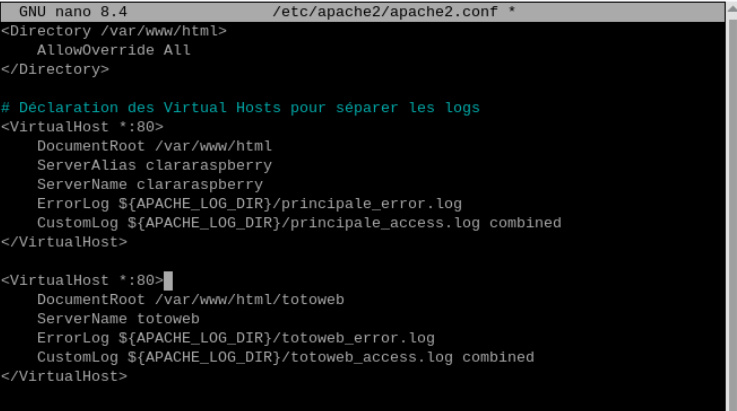</p>

On vérifie la syntaxe de la configuration avant de redémarrer :

```bash
sudo apache2ctl configtest
```

<p align="center">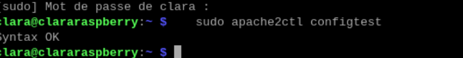</p>

La commande renvoie **Syntax OK** : la configuration ne contient pas d’erreur.

### Activation du module SSL et du site default-ssl

```bash
sudo a2enmod ssl
sudo a2ensite default-ssl
sudo systemctl restart apache2
```

La première commande active le module de chiffrement d’Apache, la deuxième active le site sécurisé fourni par défaut (qui écoute sur le port 443), et la troisième redémarre Apache pour appliquer ces changements.

### Vérifier que le site fonctionne en HTTPS et contrôler le chiffrement du mot de passe avec Wireshark

Depuis le PC Windows, on ouvre `https://clararaspberry/motdepasse.htm`, on saisit un mot de passe et on clique sur « Envoyer ». Dans Wireshark, on applique le filtre `ip.addr == 192.168.0.206 && tcp.port == 443` :

<p align="center">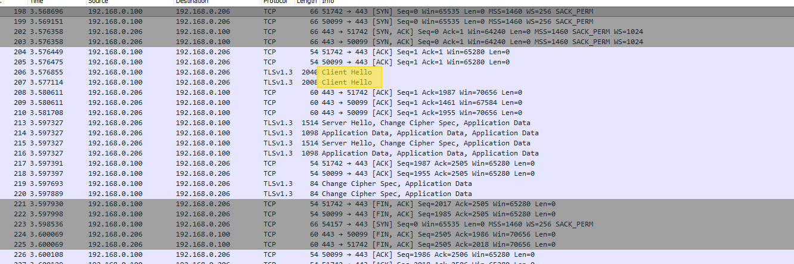</p>

La capture montre trois phases :

- **Connexion TCP** (SYN, SYN-ACK, ACK) entre le PC (192.168.0.100) et le Raspberry Pi (192.168.0.206) sur le port 443 ;
- **Négociation TLS 1.3** : le navigateur envoie un Client Hello, le serveur répond par un Server Hello, puis le chiffrement démarre (Change Cipher Spec) ;
- **Échanges chiffrés** : toutes les données suivantes apparaissent sous forme d’« Application Data » illisibles.

Contrairement au test en HTTP, ni la requête POST ni la valeur du champ passwd ne sont visibles.

> [!IMPORTANT]
> **Conclusion :** avec HTTPS, les échanges entre le navigateur et le serveur sont chiffrés. Même si le trafic est intercepté, le mot de passe ne peut pas être lu.

### Localiser le certificat SSL par défaut (valable 10 ans)

Le certificat est déclaré dans le fichier de configuration du site sécurisé, `/etc/apache2/sites-available/default-ssl.conf` :

<p align="center">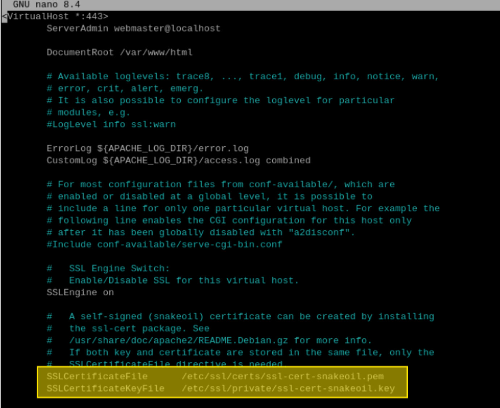</p>

Ce fichier définit un VirtualHost sur le port **443**, dans lequel la directive **SSLEngine on** active le chiffrement. Les directives **SSLCertificateFile** et **SSLCertificateKeyFile** indiquent l’emplacement du certificat public (`/etc/ssl/certs/ssl-cert-snakeoil.pem`), envoyé au navigateur, et de la clé privée (`/etc/ssl/private/ssl-cert-snakeoil.key`), qui reste sur le serveur.

On vérifie la durée de validité du certificat :

```bash
openssl x509 -in /etc/ssl/certs/ssl-cert-snakeoil.pem -noout -subject -dates
```

```text
notBefore=Jun 18 00:23:22 2026 GMT
notAfter=Jun 15 00:23:22 2036 GMT
```

Le certificat est valable du 18 juin 2026 au 15 juin 2036, soit **10 ans**. Ce certificat « snakeoil » est généré automatiquement et **auto-signé** : il n’est validé par aucune autorité de certification et ne convient qu’à des tests.

### Supprimer l’accès au site HTTP

> [!NOTE]
> Sur Debian, le site HTTP par défaut s’appelle **000-default** (et non default) :

```bash
sudo a2dissite 000-default
sudo systemctl reload apache2
```

Vérification avec `http://192.168.0.206` :

<p align="center">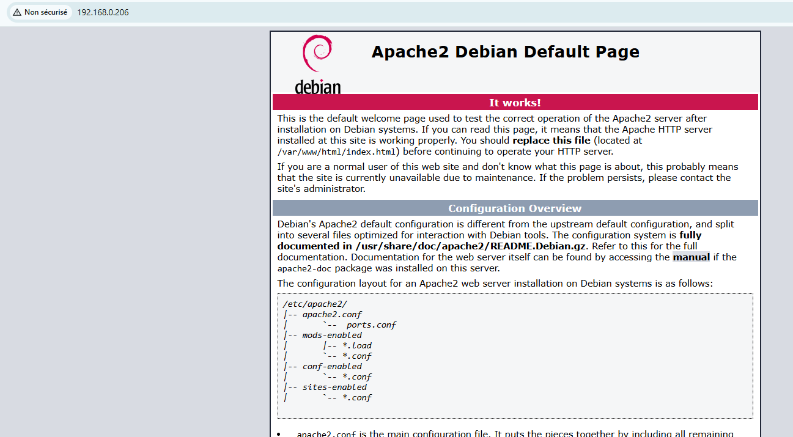</p>

Après la désactivation de 000-default, la page reste accessible en HTTP. Le VirtualHost créé dans la partie 6 écoute toujours sur le port 80 et sert le même dossier /var/www/html : c’est lui qui répond désormais. Désactiver 000-default ne coupe donc le HTTP que s’il n’existe aucun autre VirtualHost sur ce port.

### Forcer la redirection vers HTTPS

Dans le bloc `<VirtualHost *:80>` du fichier `/etc/apache2/sites-available/000-default.conf`, on ajoute la directive de redirection :

```bash
sudo nano /etc/apache2/sites-available/000-default.conf
```

```apache
Redirect permanent / https://clararaspberry/
```

<p align="center">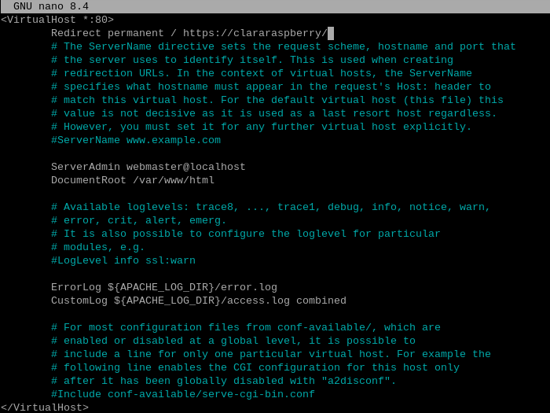</p>

La directive **Redirect permanent** renvoie au navigateur un code **301 (Moved Permanently)** accompagné de la nouvelle adresse en HTTPS.

### Remettre l’accès au site HTTP, redémarrer Apache et tester

```bash
sudo a2ensite 000-default
sudo systemctl restart apache2
```

<p align="center">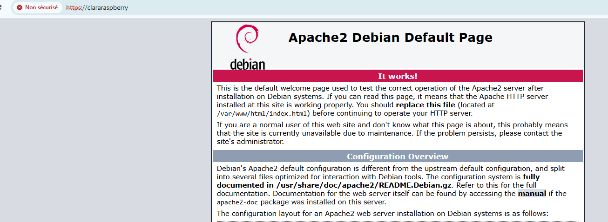</p>

En saisissant `http://192.168.0.206` depuis le PC Windows, le navigateur est automatiquement redirigé vers `https://clararaspberry` : la redirection permanente fonctionne et tout visiteur arrivant en HTTP bascule en HTTPS.

> [!NOTE]
> Le « https » barré et la mention « Non sécurisé » s’expliquent par le certificat auto-signé : la connexion est bien chiffrée, mais le navigateur ne peut pas vérifier l’identité du serveur, faute de certificat délivré par une autorité reconnue (comme Let’s Encrypt).

---

[← III. Utilisation](Partie-III-utilisation.md) · [Sommaire](README.md) · [V. Utilisation de MySQL (MariaDB) →](Partie-V-utilisation-de-mysql-mariadb.md)
