# V. Utilisation de MySQL (MariaDB)

[← IV. Apache](Partie-IV-apache.md) · [Sommaire](README.md)

**Dans cette partie :**

- [1) Intro](#1-intro)
- [2) Installation](#2-installation)
- [3) Fonctionnement](#3-fonctionnement)
- [4) Utilisation de mysql](#4-utilisation-de-mysql)
- [5) Lien avec PHP](#5-lien-avec-php)
- [6) Administration MySQL](#6-administration-mysql)

---

Cette dernière partie porte sur l’utilisation du SGBD : création d’une base et d’une table, requêtes SQL, lien avec PHP, puis administration (gestion des utilisateurs et des droits, état du serveur, sauvegarde et restauration).

## 1) Intro

MySQL est un système de gestion de bases de données (SGBD) libre, créé en 1995. Il est très souvent associé à PHP pour créer des sites web dynamiques. Ses principaux concurrents sont PostgreSQL (libre), Oracle Database et Microsoft SQL Server (propriétaires).

SQL (Structured Query Language) est le langage utilisé pour interroger et manipuler les bases de données.

MySQL a été racheté par Sun Microsystems en 2008, lui-même racheté par Oracle en 2009. MariaDB, utilisé dans ce TP, est la version libre issue de MySQL et compatible avec lui.

## 2) Installation

MariaDB a été installé dans la partie I avec le paquet mariadb-server. Le paquet php-mysql fournit à PHP l’extension **mysqli**, qui lui permet de communiquer avec MariaDB. Sa présence est visible dans la page `http://clararaspberry/phpinfo.php`, à la section mysqli.

## 3) Fonctionnement

MariaDB fonctionne selon une architecture **client/serveur** :

- le **serveur** (processus mariadbd) stocke les bases de données et assure la protection, l’intégrité et la sécurité des données ;
- les **clients** (console mysql, scripts PHP grâce à leurs fonctions dédiées, phpMyAdmin) lui envoient des requêtes SQL et reçoivent les résultats.

Le serveur est actif, comme le montre la commande `sudo systemctl status mariadb` (partie I).

## 4) Utilisation de mysql

### Création de la base Films

```bash
mysql -u root -p
```

```sql
CREATE DATABASE Films;
GRANT ALL PRIVILEGES ON Films.* TO adminFilms@localhost IDENTIFIED BY '1234';
exit
```

<p align="center">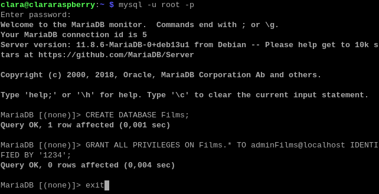</p>

Les deux commandes renvoient « Query OK » :

- **CREATE DATABASE** crée la base Films (1 row affected) ;
- **GRANT ALL PRIVILEGES** crée l’utilisateur adminFilms, avec le mot de passe 1234, et lui donne tous les droits sur la base Films uniquement. Il n’a aucun droit sur les autres bases du serveur.

Déléguer une base à un utilisateur dédié, plutôt que d’utiliser root, respecte le **principe du moindre privilège**.

### Reconnexion avec adminFilms

```bash
mysql -u adminFilms -p Films
```

> [!TIP]
> le mot de passe ne s’affiche pas pendant la saisie. Sur un clavier AZERTY, il faut taper 1234 avec la touche Maj ou le pavé numérique, sinon la connexion est refusée (ERROR 1045 : Access denied). On peut aussi indiquer le mot de passe directement, collé à l’option : `mysql -u adminFilms -p1234 Films`.

Une fois connecté, l’invite `MariaDB [Films]>` confirme que la base Films est sélectionnée.

### Création de la table, vérification et suppression

```sql
CREATE TABLE FilmSimple (
    titre VARCHAR(30),
    annee INTEGER
);
DESC FilmSimple;
DROP TABLE FilmSimple;
DESC FilmSimple;
```

<p align="center">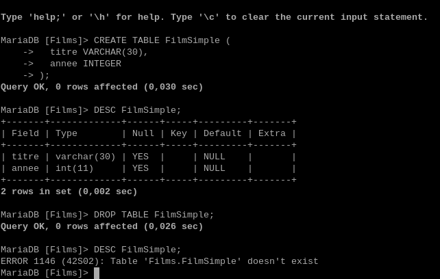</p>

- **CREATE TABLE** crée la table FilmSimple avec deux colonnes.
- **DESC** affiche sa structure : la colonne titre est une chaîne de 30 caractères maximum (varchar(30)), la colonne annee un nombre entier (int(11)). Les deux acceptent une valeur vide (Null : YES).
- **DROP TABLE** supprime définitivement la table et ses données. Le DESC suivant renvoie l’erreur 1146 « Table 'Films.FilmSimple' doesn't exist », qui confirme la suppression.

### Insertion des données

Après avoir recréé la table avec la même commande CREATE TABLE, on insère trois films :

```sql
INSERT INTO FilmSimple (titre, annee) VALUES
    ('Pulp Fiction', 1994),
    ('Alien', 1979),
    ('Titanic', 1997);
```

La commande INSERT INTO ajoute plusieurs lignes en une seule requête : chaque couple de valeurs entre parenthèses correspond à un film.

### Interrogation

```sql
SELECT titre FROM FilmSimple WHERE annee=1997;
```

La requête SELECT affiche la colonne titre des seules lignes qui respectent la condition WHERE. Elle renvoie ici le film sorti en 1997 : Titanic.

**Trouver tous les films après 1997 :**

```sql
SELECT titre FROM FilmSimple WHERE annee > 1997;
```

**Tous les films à partir de 1997 :**

```sql
SELECT titre FROM FilmSimple WHERE annee >= 1997;
```

L’opérateur **>** est strict : il exclut l’année 1997. L’opérateur **>=** l’inclut, et renvoie donc aussi Titanic.

**Utiliser phpMyAdmin pour rajouter des films :** dans `http://clararaspberry/phpmyadmin`, on ouvre la base Films, la table FilmSimple, puis l’onglet **Insérer**. On renseigne le titre et l’année, puis on clique sur **Exécuter**. phpMyAdmin génère et exécute lui-même la requête INSERT correspondante. Les films Avatar (2009) et Shutter Island ont été ajoutés de cette façon.

## 5) Lien avec PHP

On crée le fichier Test.php dans /var/www/html. Il génère une page HTML et affiche, dans le <body>, le contenu de la table FilmSimple :

```bash
sudo nano /var/www/html/Test.php
```

```php
<?php
    echo "<html>\n";
    echo "<head>\n";
    echo "<title> Test PHP </title>\n";
    echo "</head>\n";
    echo "<body>\n";

    $connexion = mysqli_connect("localhost", "adminFilms", "1234", "Films");
    $requete = "select * from FilmSimple";
    $resultat = mysqli_query($connexion, $requete);
    while ($film = mysqli_fetch_assoc($resultat)) {
        echo "<p>" . $film['titre'] . " paru en " . $film['annee'] . "</p>\n";
    }
    mysqli_close($connexion);

    echo "</body>\n";
    echo "</html>\n";
?>
```

Fonctionnement du script :

- **mysqli_connect** ouvre une connexion au serveur MariaDB (localhost) avec le compte adminFilms, sur la base Films ;
- **mysqli_query** exécute la requête SQL « select * from FilmSimple » ;
- **mysqli_fetch_assoc**, dans la boucle while, lit les résultats ligne par ligne sous forme de tableau associatif ($film['titre'], $film['annee']) ;
- **mysqli_close** ferme la connexion.

Test : `http://clararaspberry/Test.php`. La page affiche une ligne par film, sous la forme « Titanic paru en 1997 ».

**Dans phpMyAdmin, rajouter un film et tester avec Test.php :** après l’ajout d’un film dans phpMyAdmin, il suffit d’actualiser Test.php pour le voir apparaître. PHP interroge la base à chaque chargement de la page, ce qui en fait une page **dynamique**.

## 6) Administration MySQL

### Nouvel utilisateur avec tous les droits, puis retrait des droits d’écriture

```bash
mysql -u root -p
```

```sql
CREATE USER 'user1'@'localhost' IDENTIFIED BY '1234';
GRANT ALL PRIVILEGES ON Films.* TO 'user1'@'localhost';
SHOW GRANTS FOR 'user1'@'localhost';
REVOKE INSERT, UPDATE, DELETE ON Films.* FROM 'user1'@'localhost';
SHOW GRANTS FOR 'user1'@'localhost';
```

<p align="center">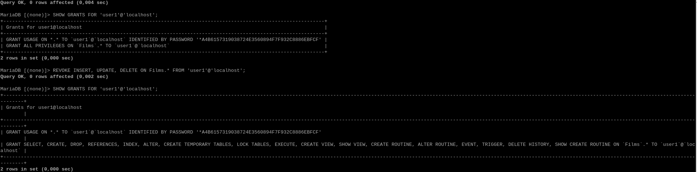</p>

Le premier SHOW GRANTS montre que user1 dispose de **ALL PRIVILEGES** sur la base Films. Après le REVOKE, le second SHOW GRANTS n’affiche plus les droits d’écriture sur les données : **INSERT** (ajouter), **UPDATE** (modifier) et **DELETE** (supprimer). user1 conserve en revanche SELECT (lecture) et les droits sur la structure des tables.

### Dans phpMyAdmin, ajout du droit de mise à jour (UPDATE)

Connecté en **root** dans phpMyAdmin (seul root peut gérer les comptes), on ouvre l’onglet **Comptes utilisateurs** :

<p align="center">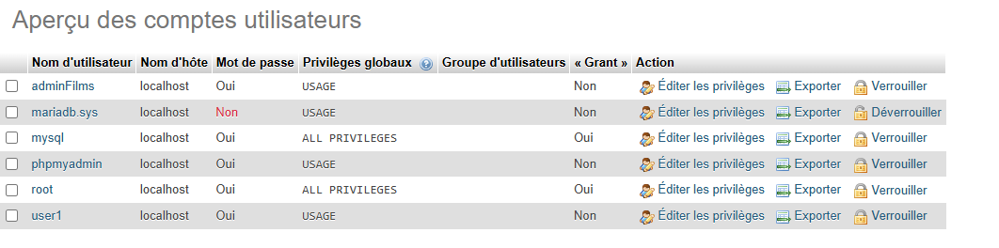</p>

La colonne Privilèges globaux indique USAGE pour user1 : ses droits ne portent pas sur tout le serveur, mais uniquement sur la base Films. On passe donc par **Éditer les privilèges > Base de données > Films** :

<p align="center">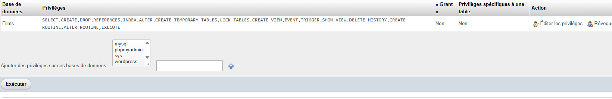</p>

On coche **UPDATE** dans la colonne Données, puis on clique sur **Exécuter**.

**Test :**

```bash
mysql -u user1 -p Films
```

```sql
UPDATE FilmSimple SET annee=1980 WHERE titre='Alien';
INSERT INTO FilmSimple (titre, annee) VALUES ('Test', 2000);
```

<p align="center">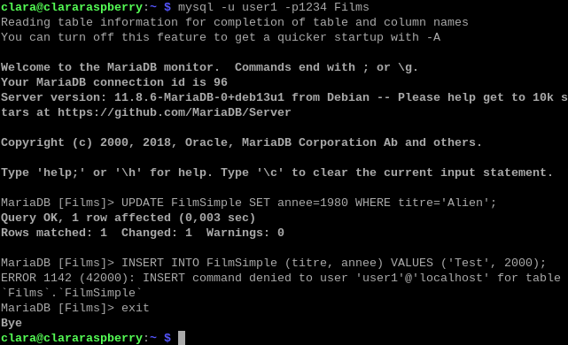</p>

- L’**UPDATE** est accepté (Query OK, 1 row affected) : le droit ajouté dans phpMyAdmin est bien pris en compte.
- L’**INSERT** est refusé (ERROR 1142 : INSERT command denied) : ce droit reste retiré.

MariaDB applique donc exactement les droits configurés : user1 peut modifier des données, mais pas en ajouter.

### Utilisateur qui n’a que le droit de sélection

```bash
mysql -u root -p
```

```sql
CREATE USER 'lecteur'@'localhost' IDENTIFIED BY '1234';
GRANT SELECT ON Films.* TO 'lecteur'@'localhost';
```

<p align="center">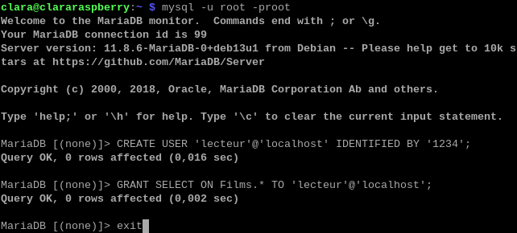</p>

L’utilisateur lecteur est créé et reçoit uniquement le droit **SELECT** sur la base Films.

**Test :**

```bash
mysql -u lecteur -p Films
```

```sql
SELECT * FROM FilmSimple;
DELETE FROM FilmSimple WHERE titre='Alien';
```

<p align="center">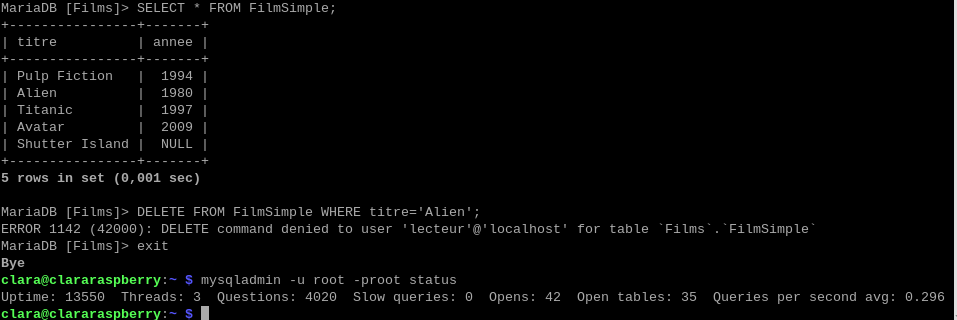</p>

- Le **SELECT** affiche les 5 films de la table : la lecture est autorisée.
- Le **DELETE** est refusé (ERROR 1142 : DELETE command denied) : toute modification est interdite.

Ce type de compte en lecture seule convient, par exemple, à une application qui doit seulement afficher des données.

### État du serveur avec mysqladmin

```bash
mysqladmin -u root -p status
```

Le résultat (dernière ligne de la capture précédente) donne un aperçu de l’activité du serveur :

- **Uptime : 13550** : le serveur tourne depuis 13 550 secondes, soit environ 3 h 45 ;
- **Threads : 3** : 3 connexions sont actuellement ouvertes ;
- **Questions : 4020** : 4 020 requêtes ont été reçues depuis le démarrage ;
- **Slow queries : 0** : aucune requête n’a dépassé le temps d’exécution jugé lent ;
- **Open tables : 35** : 35 tables sont ouvertes ;
- **Queries per second avg : 0.296** : moyenne de requêtes traitées par seconde.

### Sauvegarde de la base Films avec mysqldump

```bash
mysqldump -u root -p Films > Films.sql
cat Films.sql
```

<p align="center">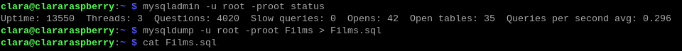</p>

La commande mysqldump exporte la base Films dans le fichier Films.sql, sous forme d’instructions SQL. La commande cat permet ensuite de consulter ce fichier :

<p align="center">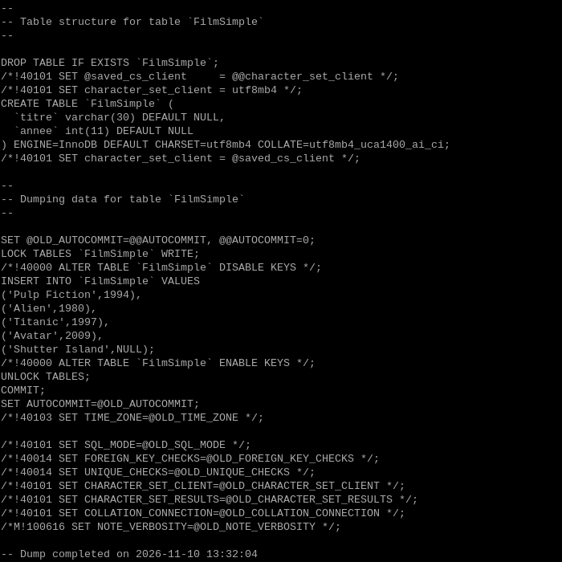</p>

- **CREATE TABLE FilmSimple** : la structure de la table, précédée d’un DROP TABLE IF EXISTS pour remplacer une éventuelle table existante lors de la restauration ;
- **INSERT INTO FilmSimple VALUES** : les 5 films, avec leurs valeurs à jour (Alien en 1980 après la modification faite par user1) ;
- **Dump completed** : la sauvegarde s’est terminée sans erreur.

Le fichier contient donc tout ce qu’il faut pour reconstruire la base à l’identique.

### Suppression de la base et restauration

```bash
mysql -u root -p
```

```sql
DROP DATABASE Films;
CREATE DATABASE Films;
exit
```

```bash
mysql -u root -p Films < Films.sql
```

Après avoir supprimé puis recréé la base (vide), on y importe le fichier de sauvegarde : le symbole < envoie le contenu de Films.sql au client mysql, qui exécute les instructions une par une. Vérification :

```bash
mysql -u root -p Films
```

```sql
SELECT * FROM FilmSimple;
```

<p align="center">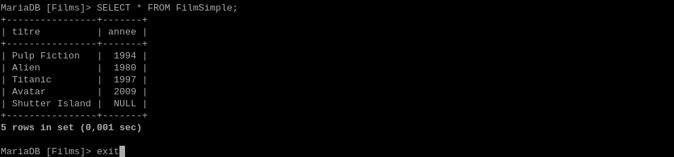</p>

La table FilmSimple et ses 5 films sont de nouveau présents, avec exactement les mêmes valeurs qu’avant la suppression. La sauvegarde avec mysqldump et la restauration fonctionnent.

---

[← IV. Apache](Partie-IV-apache.md) · [Sommaire](README.md)
